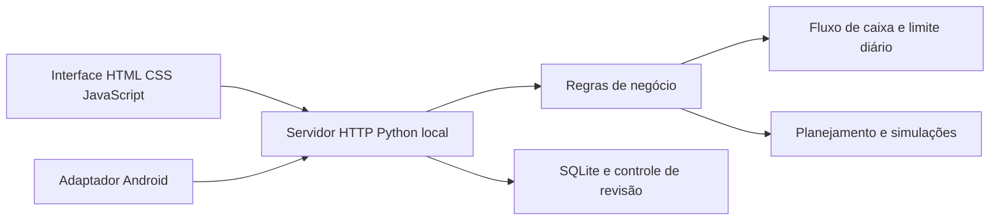

# Horizonte

**Planejamento financeiro pessoal para entender quanto posso gastar hoje e se meu saldo chega ao próximo recebimento.**

O Horizonte nasceu de uma necessidade do meu dia a dia: registrar despesas ajuda a enxergar o passado, mas eu também queria avaliar compromissos futuros antes de decidir uma compra. Construí o aplicativo com apoio de IA por vibe coding e o utilizo no meu planejamento financeiro.

Minha participação inclui definir o problema, as funcionalidades e as regras de negócio, testar versões, identificar dificuldades de uso e orientar a evolução do produto. O código foi produzido com apoio de IA; isso não é uma alegação de implementação independente de todos os módulos ou treinamento de um modelo próprio.

## O que o aplicativo faz

- Organiza receitas, despesas, contas, cartões e orçamento por categoria.
- Projeta o saldo ao longo do tempo e considera recebimentos e compromissos programados.
- Calcula um limite diário de gastos a partir do saldo e das obrigações registradas.
- Ajuda a simular o efeito de uma compra, parcelamento ou assinatura no planejamento.
- Oferece rotinas de conferência, importação de extratos OFX/CSV e comparação entre planejado e realizado.
- Mantém persistência local em SQLite e uma interface em português.

O foco do meu uso e desta apresentação está no saldo, nos compromissos e nas decisões entre recebimentos. Algumas funções complementares herdadas de versões anteriores permanecem no código.

## Arquitetura



O núcleo é Python e usa a biblioteca padrão no caminho local de execução. O APK original usa integração Chaquopy. A interface é servida no próprio computador, em `127.0.0.1`. Este diretório contém o núcleo e a interface recuperados da versão Android 5.0, organizados para execução local e estudo.

O projeto Android/Gradle e suas classes nativas não estão incluídos: `mobile_runtime.py` é um adaptador, não um projeto Android completo. Os instaladores Windows e Android não são distribuídos nesta pasta. Não há sincronização automática comprovada entre dispositivos.

## Experimentar com dados fictícios

Requer Python 3.11 ou superior; esta preparação foi verificada com Python 3.13.9. O modo local não precisa instalar bibliotecas externas. Na pasta deste projeto:

```powershell
python demo.py
```

O comando cria uma base fictícia separada em `.demo-horizonte/` e inicia a aplicação no navegador. Essa base não é a base pessoal padrão do Horizonte. Se a pasta da demonstração já existir, suas alterações serão preservadas em vez de reinicializadas.

Para iniciar sem abrir uma janela automaticamente e escolher a porta:

```powershell
python demo.py --no-open --port 8770
```

Abra no mesmo computador a URL impressa pelo programa, incluindo o token local. Use **Ctrl+C** no terminal para encerrar. Evite compartilhar a URL com token. O servidor foi iniciado nesta preparação, mas a conexão do navegador de automação com localhost foi bloqueada pelo ambiente; portanto não se declara teste visual completo da interface.

Para criar uma base pessoal nova em uma pasta explicitamente escolhida:

```powershell
python app.py --data-dir .\meus-dados
```

Essa pasta contém dados privados e não deve ser enviada ao GitHub. Para portfólio e gravações, use a demonstração fictícia.

## Conferir as regras centrais

```powershell
python -m unittest discover -s tests -v
```

Oito testes passaram nesta preparação: limite do período anterior ao recebimento, detecção de insuficiência de saldo, ausência de renda programada, preservação dos dados de entrada, separação entre renda futura e dinheiro disponível, efeito de contas adicionais no limite diário, saldo desconhecido e compatibilidade do cenário fictício com o esquema da aplicação.

Essa suíte é inicial. Não reproduz a suíte mencionada no histórico de desenvolvimento e não representa validação integral dos módulos, instaladores ou experiência de uso.

## Regras que explicam o produto

As projeções dependem dos dados cadastrados. Valores monetários são tratados em centavos inteiros. Recebimentos previstos aparecem na linha do tempo, mas não viram automaticamente saldo disponível para gastar hoje. Sem saldo informado, o aplicativo sinaliza a informação ausente em vez de inventar um limite.

O período anterior ao próximo recebimento termina no dia anterior à data prevista. O cálculo não presume que um depósito ocorrerá antes de uma conta no mesmo dia. O limite diário também considera o orçamento e os dias restantes do mês; ele não é simplesmente o salário dividido pelo número de dias até receber.

Leia [as regras de negócio](docs/regras-de-negocio.md) e [o estudo de caso](docs/estudo-de-caso.md) para uma explicação mais detalhada.

## Como usei IA na construção

Usei IA para transformar requisitos em código e evoluir o aplicativo por iterações. Minha contribuição principal foi decidir o que precisava resolver, descrever o comportamento esperado, testar o produto e dar feedback. Um exemplo foi identificar que o fluxo de fotografia de nota fiscal não funcionava como esperado e relatar a falha.

IA utilizada durante o desenvolvimento não significa que cada funcionalidade usa um modelo de IA em tempo de execução. As projeções examinadas são regras determinísticas. Há recursos de OCR no pacote Android original, mas a leitura de notas não foi validada nesta revisão do repositório. Não são alegados fine-tuning, modelo próprio, usuários externos ou ganho financeiro medido.

## Estrutura

| Arquivo ou pasta | Responsabilidade |
|---|---|
| `app.py` | Inicialização, servidor local e rotas |
| `storage.py` | Persistência SQLite, validação e revisão de estado |
| `cashflow.py` | Calendário de compromissos e projeção de saldo |
| `spending.py` | Capacidade de gasto e simulações |
| `focus.py` | Contas, extratos e planejamento por recebimentos |
| `static/` | Interface HTML, CSS e JavaScript |
| `demo.py` | Cenário fictício separado da base pessoal |
| `tests/` | Verificações iniciais reproduzíveis |
| `docs/` | Regras, estudo de caso e limites da validação |

## Limites e privacidade

Não é integração bancária nem garantia de saldo futuro. Obrigações omitidas, atraso de recebimentos ou informações incorretas alteram as projeções. As estimativas tributárias e de investimentos existentes em módulos complementares não foram auditadas nesta preparação. Recursos opcionais de consultas online ou envio de relatórios exigem configuração própria e não fazem parte da demonstração fictícia.

O material publicado contém código e um gerador de cenário fictício. Não inclui meu banco pessoal, extratos, backups, credenciais ou instaladores. Os filtros em `.gitignore` ajudam a manter esses arquivos fora do versionamento, mas não substituem conferir os arquivos antes de cada publicação.

Não foi adicionada uma licença abrangente nesta organização do projeto. Menções de licença já existentes em módulos foram preservadas; os termos de redistribuição do conjunto precisam ser definidos pelo responsável.
